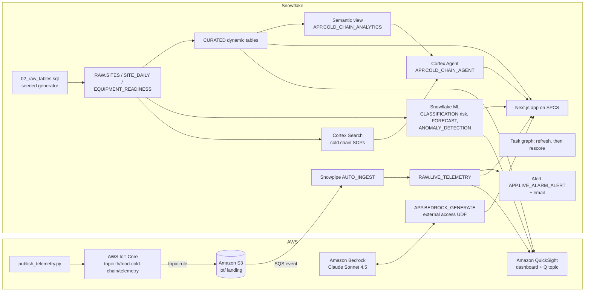

# Thailand Food Cold Chain Control Tower

Temperature-controlled food distribution monitoring for a **fictional food distributor's network of 30 cold chain sites across 6 Thai hub cities** (Bangkok, Samut Sakhon, Chon Buri, Chiang Mai, Khon Kaen, Hat Yai) using Snowflake, optionally with AWS: from frozen warehouses and chilled distribution centers through seafood processing docks and cross-docks to reefer truck depots, with pallet-level temperature compliance, a live dock-dwell alarm, a 7-day disruption-risk score, an alarm email and an AI action memo.

## Architecture

A cold chain control-tower pipeline built on **Snowflake** (Dynamic Tables, Snowflake ML, Cortex Search, Cortex Agent, Cortex AI_COMPLETE, SPCS) and, in the full build, **AWS** (IoT Core, S3, Bedrock Claude, QuickSight + Amazon Q). Cold room and reefer sensors (pallet dock dwell hours, refrigeration compressor load) land in `RAW.LIVE_TELEMETRY`. Dynamic tables curate 90 days of site-day history: pallets handled, temperature-compliant pallets (kept within their temperature band and delivered in the committed window), temperature checks, excursion checks, disruptions and refrigeration uptime. Snowflake ML scores 7-day disruption risk per site, forecasts network-wide pallet volume and flags pallet dock-dwell anomalies. A Cortex Agent answers questions with SOP citations, and an LLM drafts the cold chain action memo.

Interactive diagrams (hover for object names): [Snowflake only](docs/architecture-snowflake.html) | [AWS + Snowflake](docs/architecture-aws.html). The app shows both on its Architecture & Data tab, the current build first. Regenerate them with `python3 docs/build_architecture.py`.



The Snowflake-only build drops the AWS subgraph: `APP.SIMULATE_TELEMETRY` writes to `RAW.LIVE_TELEMETRY`, and the app calls Cortex `AI_COMPLETE` instead of the Bedrock UDF.

## Snowflake Capabilities

| Capability | Implementation |
|-----------|---------------|
| Dynamic Tables | `CURATED.KPI_SUMMARY`, `PERFORMANCE_SUMMARY`, `DISRUPTION_CAUSES`, `TREND_ANALYSIS` from the RAW tables |
| Snowflake ML | CLASSIFICATION 7-day disruption risk (`ML.DISRUPTION_RISK_SCORES`), 14-day pallet-volume FORECAST, pallet dock-dwell ANOMALY_DETECTION |
| Cortex Search | 20 synthetic cold chain response SOPs (one per site type and cause) in `SEARCH.SITE_SOP_SEARCH` |
| Semantic View | `APP.COLD_CHAIN_ANALYTICS` over sites, disruption causes, daily pallet flow and risk |
| Cortex Agent | `APP.COLD_CHAIN_AGENT`: Cortex Analyst over the semantic view plus Cortex Search for SOP citations |
| Cortex AI | `AI_COMPLETE('claude-sonnet-4-5')` for grounded answers, and for the action memo in the Snowflake-only build |
| Alerts + Tasks | `APP.LIVE_ALARM_ALERT` logs ALARM readings and sends email; task graph `TASK_REFRESH_CURATED`, then `TASK_RESCORE_RISK` |
| Snowpark Container Services | Next.js app `APP.TH_FOOD_COLD_CHAIN_APP` with 6 tabs: Executive Cockpit, Predictive, Site Health, Live IoT, Ask AI, Architecture & Data |
| Snowpipe | `RAW.LIVE_TELEMETRY_PIPE` AUTO_INGEST from S3 (AWS build only) |

## AWS Services

Used only in the AWS + Snowflake build.

| Service | Role in Demo |
|---------|-------------|
| AWS IoT Core | Receives simulated cold room and reefer sensor telemetry (pallet dock dwell hours, compressor load). A topic rule writes each message to S3 |
| Amazon S3 | Landing bucket. An event notification goes to the Snowpipe SQS queue |
| Amazon Bedrock | Claude Sonnet 4.5 writes the action memo, called from Snowflake through an external-access UDF |
| Amazon QuickSight | DIRECT_QUERY executive dashboard over Snowflake (daily temperature-compliant pallets, disruptions by site, disruption risk) |
| Amazon Q | Natural-language questions over the QuickSight topic `th-food-cold-chain-topic` |
| AWS IAM | Least-privilege roles for S3, IoT and Bedrock |

## Personas

These personas are fictional.

| Persona | Role | Key Questions |
|---------|------|---------------|
| **Pimchanok Saelee** | VP Cold Chain Operations | "Which hub city has the lowest in-range rate?" "Which disruption causes push the most pallets out of range?" |
| **Anucha Thongdee** | Cold Chain Network Planner | "Which sites are high disruption risk this week, and which SOP applies?" |

## Data

All data is synthetic and seeded, so every rebuild reproduces it. The distributor, its sites and its network are fictional; the six hub cities are real Thai cities used as regions. No real company, carrier, cold store operator or facility is represented, and no food safety or regulatory compliance is claimed for any real site.

| Table | Rows | Description |
|-------|------|-------------|
| RAW.SITES | 30 | Cold chain sites across 6 hub cities and 5 site types (Frozen Warehouse, Chilled Distribution Center, Seafood Processing Dock, Cross-Dock, Reefer Truck Depot) |
| RAW.SITE_DAILY | 2,700 | Daily site observations over 90 days: pallets, temperature-compliant pallets, order fill, temperature checks, excursion checks, disruptions, root cause, PM, pallet dock dwell hours and compressor load |
| RAW.EQUIPMENT_READINESS | 30 | Compressor racks, evaporator units, blast freezers, dock door seals or reefer units required and on hand per site |
| SEARCH.SITE_SOP_DOCS | 20 | Synthetic cold chain response SOPs indexed for Cortex Search |
| RAW.LIVE_TELEMETRY | Grows during the demo | Live readings from IoT Core (AWS build) or `APP.SIMULATE_TELEMETRY` (Snowflake-only build) |
| ML.DISRUPTION_RISK_SCORES | 30 | 7-day disruption probability and risk band per site |

Pallet traceability: each site-day carries temperature-compliant pallets and the order fill rate of the pallets it handled, and every SOP asks operators to tag affected pallets with their lot and order IDs and record the last logged product temperature.

## Build Instructions

### Prerequisites
- Snowflake account with ACCOUNTADMIN access, and Cortex AI enabled (AI_COMPLETE, Search, Agent).
- An X-Small warehouse with auto-suspend at or below 120 s, and an existing SPCS compute pool.
- Python 3.11+, `snowflake-connector-python`, Node.js 22+, Docker and the `snow` CLI.
- App image: run `snow spcs image-registry login`, then build and push `th-food-cold-chain-app:v1` to the database's `APP.IMAGES` repository (see the header of `snowflake/07_deploy_app.sql`).
- AWS build only: `boto3`, AWS credentials for the target account (us-west-2) with Bedrock access, and QuickSight Enterprise.

### SPCS App
```
<DATABASE>.APP.TH_FOOD_COLD_CHAIN_APP
```

### Tests
```bash
python -m pytest aws snowflake quicksight
```

For a local run, put `SNOWFLAKE_ACCOUNT`, `SNOWFLAKE_USER`, `SNOWFLAKE_DATABASE`, `SNOWFLAKE_WAREHOUSE`, `SNOWFLAKE_AUTHENTICATOR=PROGRAMMATIC_ACCESS_TOKEN`, `SNOWFLAKE_TOKEN` and `DEMO_PLATFORM` in the environment, then run `npm --prefix app run build && npm --prefix app start`.

## Build Modes

Both modes share the same core. They differ in three places, and the app's `DEMO_PLATFORM` setting (in its SPCS spec) switches the memo provider and the Live IoT tab.

| Layer | Snowflake Only | Full AWS + Snowflake |
|---|---|---|
| Live telemetry | `CALL APP.SIMULATE_TELEMETRY(n)` inserts simulated readings into `RAW.LIVE_TELEMETRY`. This simulates a sensor feed; it is not Snowpipe Streaming | `aws/publish_telemetry.py` to AWS IoT Core, then S3, SQS and Snowpipe AUTO_INGEST |
| Action memo | Cortex `AI_COMPLETE('claude-sonnet-4-5')` | Amazon Bedrock Claude Sonnet 4.5 through `APP.BEDROCK_GENERATE` |
| BI and natural-language questions | The SPCS app is the dashboard; questions go to the Cortex Agent | Also a QuickSight dashboard and an Amazon Q topic |
| App setting | `DEMO_PLATFORM: snowflake` | `DEMO_PLATFORM: aws` |

### Snowflake Only

```bash
# 1. Core data and dynamic tables (guarded: new isolated database only)
python snowflake/run_core.py --database THAILAND_FOOD_COLD_CHAIN_SNOWFLAKE --warehouse <XS_WAREHOUSE> --connection <CONNECTION> --apply
# 2. Native telemetry, ML, search, semantic view, agent, alert and task graph
python snowflake/run_intelligence.py --database THAILAND_FOOD_COLD_CHAIN_SNOWFLAKE --platform snowflake --warehouse <XS_WAREHOUSE> --connection <CONNECTION> --alert-email you@example.com
# 3. App on SPCS with DEMO_PLATFORM=snowflake (push the image first)
python snowflake/run_intelligence.py --database THAILAND_FOOD_COLD_CHAIN_SNOWFLAKE --platform snowflake --warehouse <XS_WAREHOUSE> --connection <CONNECTION> --alert-email you@example.com --files 07_deploy_app.sql --compute-pool <COMPUTE_POOL>
```

During the demo:
- Run `CALL APP.SIMULATE_TELEMETRY(20)` to add live readings. For a continuous feed, run `ALTER TASK APP.TASK_SIMULATE_TELEMETRY RESUME`, and `SUSPEND` it afterwards.
- Run `EXECUTE ALERT APP.LIVE_ALARM_ALERT` to raise the alarm email.
- Run `EXECUTE TASK APP.TASK_REFRESH_CURATED` to refresh the curated tables and rescore risk.

Afterwards, drop the database or run `ALTER SERVICE APP.TH_FOOD_COLD_CHAIN_APP SUSPEND`.

### Full AWS + Snowflake

```bash
# 1. Core data and dynamic tables (guarded: new isolated database only)
python snowflake/run_core.py --database THAILAND_FOOD_COLD_CHAIN_AWS --warehouse <XS_WAREHOUSE> --connection <CONNECTION> --apply
# 2. AWS ingestion and Bedrock (dry run first, then --apply)
python aws/setup_aws.py --database THAILAND_FOOD_COLD_CHAIN_AWS --account <AWS_ACCOUNT_ID> --connection <CONNECTION> --apply
# 3. ML, search, semantic view, agent, alert and task graph
python snowflake/run_intelligence.py --database THAILAND_FOOD_COLD_CHAIN_AWS --platform aws --warehouse <XS_WAREHOUSE> --connection <CONNECTION> --alert-email you@example.com
# 4. App on SPCS with DEMO_PLATFORM=aws (push the image first)
python snowflake/run_intelligence.py --database THAILAND_FOOD_COLD_CHAIN_AWS --platform aws --warehouse <XS_WAREHOUSE> --connection <CONNECTION> --alert-email you@example.com --files 07_deploy_app.sql --compute-pool <COMPUTE_POOL>
# 5. QuickSight dashboard and Q topic (needs an existing Snowflake data source)
python quicksight/build_dashboards.py --database THAILAND_FOOD_COLD_CHAIN_AWS --account <AWS_ACCOUNT_ID> --principal-arn <QUICKSIGHT_USER_ARN> --data-source-arn <DATA_SOURCE_ARN> --prefix th-food-cold-chain --apply --update --with-topic
```

QuickSight objects must be shared with the QuickSight user who signs in (`--principal-arn`); otherwise the console shows nothing.

During the demo:
- Run `python aws/publish_telemetry.py --count 20` to send live readings.
- Run `EXECUTE ALERT APP.LIVE_ALARM_ALERT` to raise the alarm email.
- Run `EXECUTE TASK APP.TASK_REFRESH_CURATED` to refresh the curated tables and rescore risk.

Afterwards, `python aws/teardown_aws.py --database THAILAND_FOOD_COLD_CHAIN_AWS --account <AWS_ACCOUNT_ID> --connection <CONNECTION> --apply` removes the AWS resources and the account-level Bedrock external-access and S3 storage integrations. It leaves the email integration `TH_FOOD_COLD_CHAIN_EMAIL_INT`, which the Snowflake-only build also uses.

## Business Impact

Snowflake customer outcomes in transportation and logistics:
- **Penske Logistics** (Snowflake customer, supply chain and logistics) reports "<15 days to build a new AI summarization model" with Cortex AI, and its business analysts "create BI reports with companywide data spanning five years in just 15 minutes" -- [Snowflake customer story: Penske](https://www.snowflake.com/en/customers/all-customers/case-study/penske/)
- **Ryder** (Snowflake customer, fleet management and supply chain) reports that "Ryder's unplanned data outages occur 33% less often, and latency events have essentially dropped to zero" -- [Snowflake customer story: Ryder](https://www.snowflake.com/en/customers/all-customers/case-study/ryder/)

## Key Demo Numbers

These figures are synthetic and come from the seeded demo data. Forecast and anomaly figures can shift slightly with the build day.

- **30 sites**, 2,700 site-days over 90 days, across 6 hub cities and 5 site types; **975,029 pallets** handled
- **Temperature-compliant pallets 89.3%**; per-site in-range rate ranges from 85.4% to 92.8%, and Chon Buri is the lowest hub city at 87.9%
- **415 cold chain disruptions** across 14 root causes; reefer truck no-shows push the most pallets out of range
- **Disruption-risk model** out-of-time holdout: precision 0.67, recall 0.63 at a 0.5 threshold, against a 0.53 base rate (a modest lift; present it as triage). 15 sites are high risk; the top site is CC-0011, at 99.4%
- **14-day pallet-volume forecast** with prediction intervals; **37 of 480** site-days flagged as pallet dock-dwell anomalies
- **Refrigeration uptime 98.4%**, refrigeration readiness 84.9%, 19.20 excursion checks per 1,000 temperature checks
- **20 SOPs** indexed for Cortex Search and cited by ID in agent answers

## License

Apache 2.0 — See [LICENSE](LICENSE) for details.

This is a personal demo project and is not an official Snowflake offering. It comes with no support or warranty. Industry metrics cited are from publicly available third-party research and Snowflake customer stories; they represent reported outcomes and are not guarantees of results.
